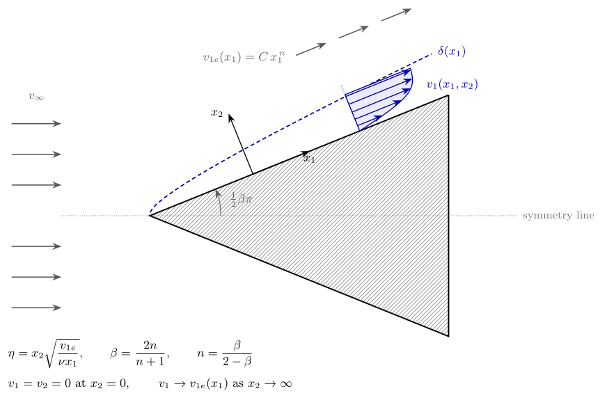

# Falkner–Skan boundary-layer solver

[](https://github.com/mrodrig6/basic_faulkner_skan/actions/workflows/ci.yml)
[](LICENSE)

Compute the steady laminar boundary layer over a wedge, including the Blasius flat plate. This Python solver is intended for learning fluid mechanics and exploring how a pressure gradient changes a velocity profile.



- Velocity and stream-function profiles from a shooting solver.
- Dimensionless wall shear, displacement thickness, momentum thickness, and shape factor.
- Continuation and parameter sweeps across wedge angles.
- CSV exports and publication-style plots, with optional Numba acceleration.

Use the returned arrays and Matplotlib axes to [make custom plots](docs/api/extending.md).

## Install

Python 3.9 or newer is required. From a checkout of this repository:

```bash
python -m pip install -e ".[fast]"  # use .[dev,docs] for development and documentation
```

See [installation](docs/getting-started/installation.md) for requirements, extras, and verification.

## Quick start

Run these commands from the repository root after installation:

```bash
# Inspect the command-line options.
python -m falkner_skan --help
# Solve the flat plate and a mild favourable pressure gradient.
python -m falkner_skan -n 0 0.05
# Export one velocity profile to CSV.
python -m falkner_skan -n 0.2 --csv /tmp/falkner-skan/csv
# Generate the built-in plots in a separate output directory.
python -m falkner_skan.figures -o /tmp/falkner-skan/figures
```

```python
from falkner_skan import solve_continuation

solution = solve_continuation(0.2)
print(f"wall shear: {solution.wall_shear:.6f}")
# wall shear: 0.621324
```

Follow the [complete quick start](docs/getting-started/quick-start.md) to interpret the output.

## Documentation

| Section | Pages |
|---|---|
| Getting started | [Installation](docs/getting-started/installation.md) · [Quick start](docs/getting-started/quick-start.md) · [Examples](docs/getting-started/examples.md) |
| Running | [Command line](docs/running/command-line.md) · [Configuration](docs/running/configuration.md) · [Output](docs/running/output.md) · [Continuation and sweeps](docs/running/continuation.md) · [Figures](docs/running/figures.md) · [Troubleshooting](docs/running/troubleshooting.md) |
| Python API | [Package](docs/api/package.md) · [Custom plots](docs/api/extending.md) |
| Model | [Problem and assumptions](docs/model/problem.md) · [Parameters](docs/model/parameters.md) |
| Method | [Shooting and robustness](docs/method/shooting.md) · [Integration](docs/method/integration.md) · [Backends and performance](docs/method/backends.md) |
| Theory | [Derivation](docs/theory/derivation.md) · [Derived quantities](docs/theory/derived-quantities.md) |
| Validation | [Tests](docs/validation/tests.md) · [Classical solutions](docs/validation/classical-solutions.md) · [SciPy comparison](docs/validation/scipy.md) · [Reference values](docs/validation/reference-values.md) |
| Reference | [Compatibility](docs/reference/compatibility.md) · [Code map](docs/reference/code-map.md) · [Repository](docs/reference/repository.md) · [Checks and CI](docs/reference/ci.md) |

This is a Python port of an educational MATLAB shooting solver. The background follows Kundu and Cohen, *Fluid Mechanics*, 4th edition; no project paper or DOI is specified.

## License

[GNU General Public License v3.0](LICENSE).
