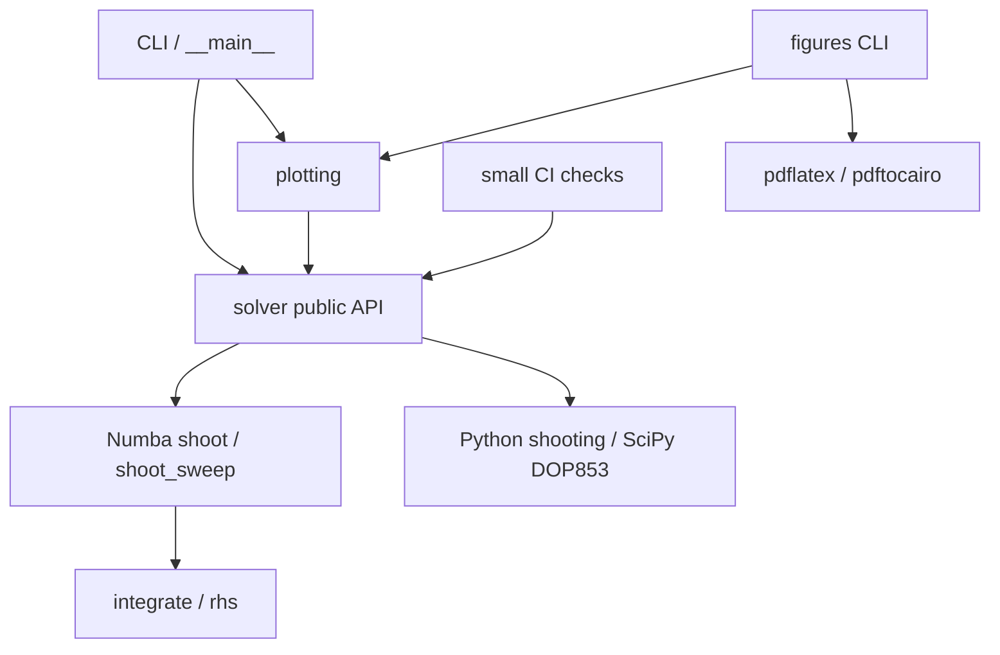

# Code map

This page maps implementation modules to their public entry points. Solver logic remains separate from plotting, CLI handling, and documentation tools.

| Path | Contents | Main names |
|---|---|---|
| `falkner_skan/__init__.py` | Public exports and package example | `solve`, `solve_continuation`, `sweep`, `FalknerSkanSolution`, `ConvergenceError` |
| `falkner_skan/__main__.py` | Module entry point | Calls `cli.main` |
| `falkner_skan/_version.py` | Version constant | `__version__` |
| `falkner_skan/solver.py` | Public API and SciPy fallback | Solver functions, angle conversions, `_shoot_scipy` |
| `falkner_skan/_kernels.py` | Numba numerical core | `rhs`, `integrate`, `shoot`, `shoot_sweep` |
| `falkner_skan/cli.py` | Arguments, progress, CSV exports | `main`, `_build_parser` |
| `falkner_skan/plotting.py` | Figure builders and export | `plot_profiles`, `plot_profile_family`, `plot_wall_shear`, `save_all` |
| `falkner_skan/figures.py` | Figure and geometry CLI | `main`, `build_geometry` |
| `examples/example_profiles.py` | Original two-case workflow | `main`, `report` |
| `examples/benchmark.py` | Optional backend timing comparison | `main`, `time_it` |
| `tools/check_simulations.py` | Small numerical CI checks and timings | `main` |
| `docs/hooks.py` | Virtual homepage and repository links | `on_files`, `on_page_markdown` |
| `docs/figures/rebuild.py` | Documentation gallery source | `main` |

The code lives in the [source directory](https://github.com/mrodrig6/basic_faulkner_skan/tree/master/falkner_skan). See [the API](../api/package.md) for supported calls; private names describe the implementation rather than an extension contract.
