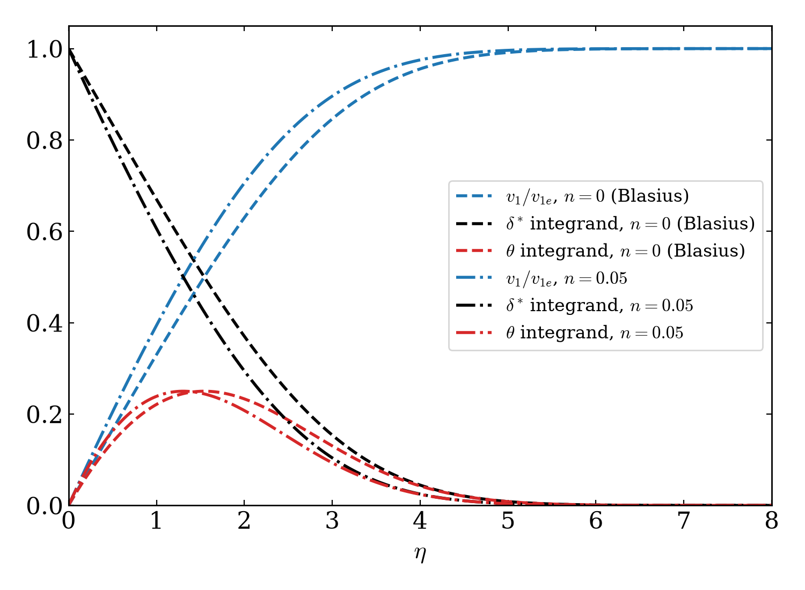
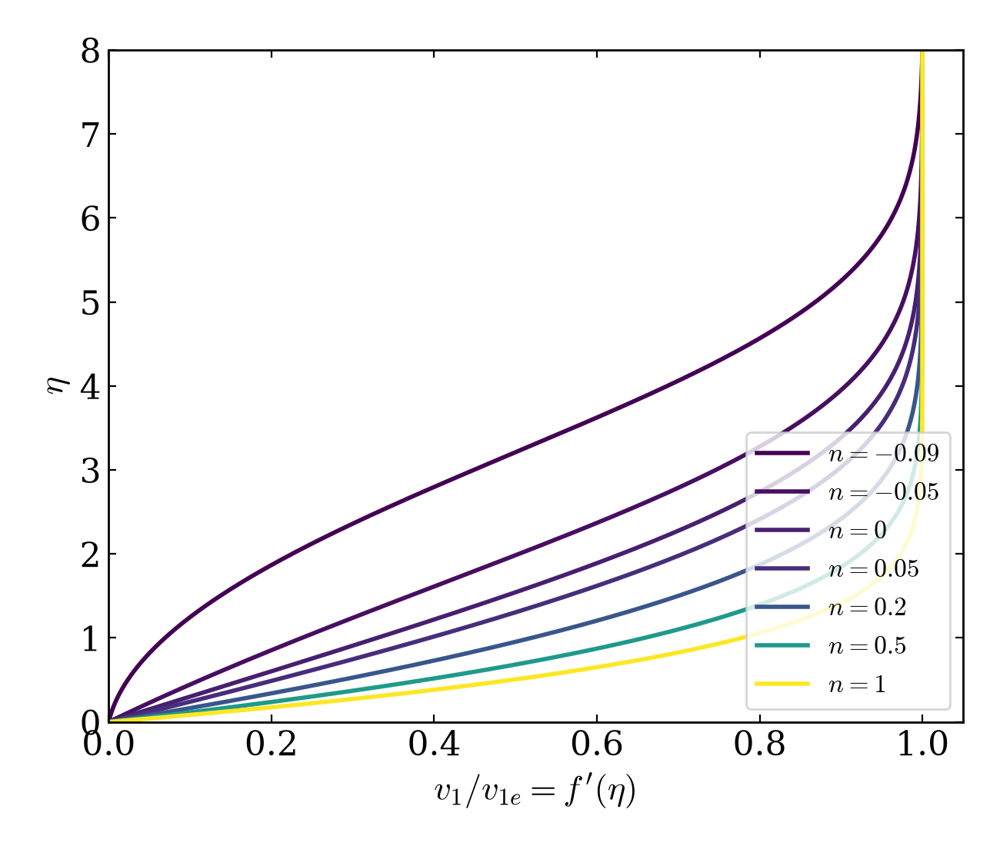
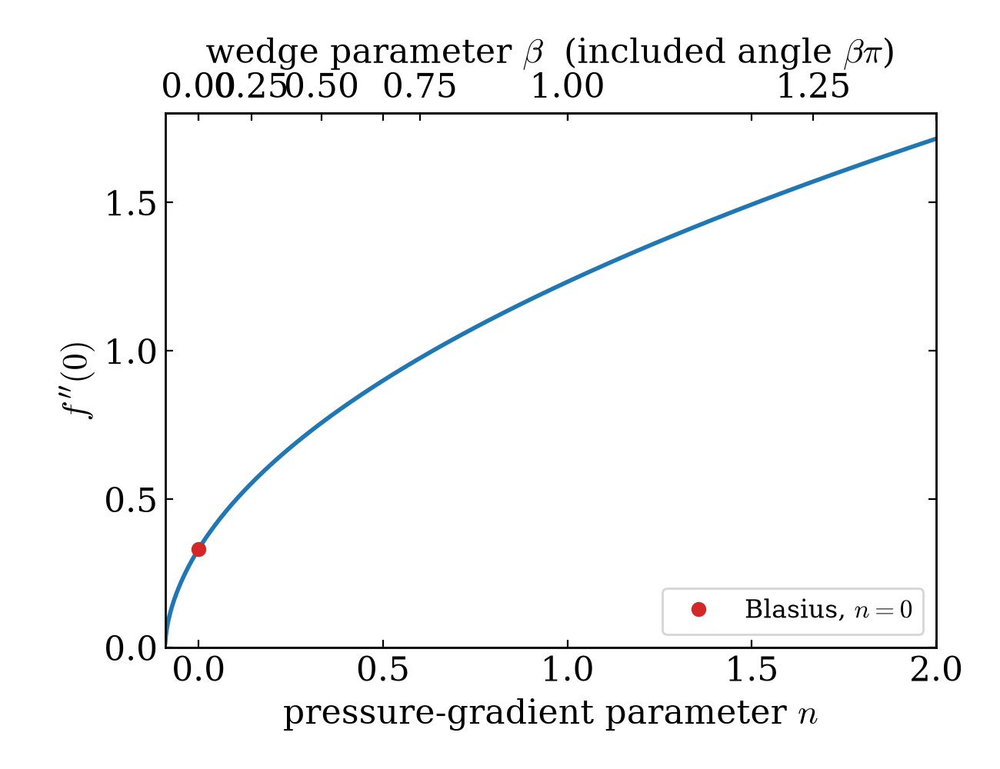

# Figures

`falkner_skan.plotting` generates three solver figures, and `falkner_skan.figures` manages their export. The separate geometry sketch uses TikZ and illustrates the problem rather than a computed velocity profile.

## Solver figures

```bash
# Save built-in solver plots without overwriting the tracked gallery.
python -m falkner_skan.figures -o /tmp/falkner-skan/figures
```

| Stem | Builder in `plotting.py` | Contents |
|---|---|---|
| `velocity_profiles` | `plot_profiles` | Velocity and displacement/momentum integrands for `n=0` and `n=0.05` |
| `profile_family` | `plot_profile_family` | Velocity profiles from adverse to favourable gradients |
| `wall_shear` | `plot_wall_shear` | Shear versus `n`, with a wedge-parameter axis |

The defaults write each stem as PNG and PDF. `save_all` closes its figures after saving. Outputs overwrite files with matching names.

The images below are rebuilt by the adjacent [rebuild script](../figures/rebuild.py), which calls the public plotting API. The original root `figures/` gallery remains available for existing links.







`python -m falkner_skan --figures DIR` calls `save_all(DIR)` with the same built-in cases, even if `-n` selects other cases. For a chosen solution, use the [custom plot recipe](../api/extending.md).

## Problem geometry


The source [geometry.tex](../figures/geometry.tex) sits beside its [PDF](../figures/geometry.pdf) and PNG. It contains the rebuild comment and a reusable `tikzpicture` environment. Load `tikz` with the `arrows.meta` and `patterns` libraries when embedding that environment in another document.

Install `pdflatex`, TikZ, the `standalone` document class, and `pdftocairo`. On Debian/Ubuntu these come from `texlive-latex-base`, `texlive-pictures`, `texlive-latex-extra`, and `poppler-utils`.

```bash
# Rebuild only the tracked geometry PDF and PNG.
python -m falkner_skan.figures --only-geometry
```

Alternatively, from `docs/figures/`:

```bash
pdflatex -interaction=nonstopmode -halt-on-error geometry.tex
pdftocairo -png -r 140 -singlefile geometry.pdf geometry
```

Change `\halfangle` in the source to redraw the wedge. The drawn layer grows as a square root and uses a `tanh` profile for illustration; these curves are not numerical results for the selected wedge. Missing TeX or conversion tools print a skip message, so a zero exit status alone does not prove geometry rebuilding succeeded.
